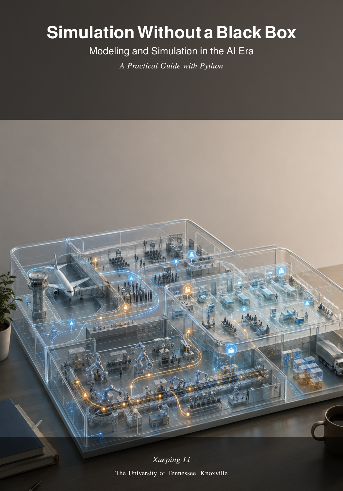

# Simulation Without a Black Box — Open Course Materials

**Discrete-Event Modeling and Analysis for the AI Era**

<p align="center">
  
</p>

Welcome! This is the **public companion repository** for the open textbook
*Simulation Without a Black Box* — a free, code-first course for teaching and
learning discrete-event simulation (DES) with Python and SimPy.

Everything here is free to read and run. The licenses differ by part: see [License](#license).

<p align="center">
  <a href="https://ilabutk.github.io/courseware_simulation_public/">
    <strong>🚀 Live Demo: EP01 Emergency Department Simulation</strong>
  </a>
  &nbsp;— interactive 3D dashboard running in your browser.
</p>

---

## For Instructors

If you are an instructor adopting this course, we have a **private repository**
with the full instructor package — including **editable slide sources, editable
assignment sources, grading rubrics, and complete annotated solutions** to every
assignment and problem.

<p align="center">
  <a href="https://ilabutk.github.io/courseware_simulation_instructors/">
    <strong>👉 Request Instructor Access</strong>
  </a>
  &nbsp;&nbsp;—&nbsp;&nbsp;verified instructors get a GitHub collaborator invitation to the private repo.
</p>

The public materials here give students everything they need to work through the
course. The instructor-only materials add the tools to teach, customize, and assess.

---

## What's in this repo

| What | Details |
|---|---|
| 📖 **Textbook PDF** | 15 chapters, free to read |
| 🖥️ **Lecture handouts** | PDFs of the interactive lectures L01–L25 (`course/modules/*/live/`) |
| 🧪 **Lecture code** | The code built in class, with tests (`course/modules/*/code/`) |
| 📝 **Assignments** | HW-00–06 and the team project (P1–P7): statements only |
| 🧩 **Problem bank** | 48 problems, including 12 *critique-the-AI* problems, and 27 open-ended capstone problems |
| 🚑 **Showcase** | EP01, an emergency department study as a product: model, decision memo, technical report, infographic and a [live app](https://ilabutk.github.io/courseware_simulation_public/) |
| 🏥 **Case studies** | Outpatient clinic and cargo terminal |
| 💻 **`simdes` Python package** | Queueing, inventory, clinic and terminal models on SimPy, with analysis tools and event traces |
| 🏗️ **Project template** | Start your own study: [courseware_simulation_project_template](https://github.com/ilabutk/courseware_simulation_project_template) |
| 📋 **Syllabus** | Spring 2027 syllabus and lecture schedule |

**During a running course** (Spring 2027: January to May), lecture handouts, lecture code,
assignments and data files appear here as the course reaches them. Everything is here after the
last class.

Older slide PDFs and some Jupyter notebooks remain in the module folders as extra reading.

---

## Quick start

You need [Docker Desktop](https://www.docker.com/products/docker-desktop/) and
[VS Code](https://code.visualstudio.com/) with the Dev Containers extension (or use
GitHub Codespaces in the browser).

```bash
git clone https://github.com/ILABUTK/courseware_simulation_public.git
```

Open the folder in VS Code and choose **Reopen in Container**. You get Python with
`simdes` installed. Then, for example:

```bash
cd course/modules/M05_simpy_queues/code
python -m pytest
```

Course code is in `.py` files with `# %%` cells: run them cell by cell in VS Code.

To start your own simulation study, use the project template linked above.

---

## What's where

```
courseware_simulation_public/
├── book/                        # Textbook PDF
├── course/
│   ├── syllabus/                # Syllabus PDF
│   ├── modules/                 # M01–M12: lecture handouts, code, readings
│   ├── assignments/             # Assignment statements (PDF)
│   ├── problem_bank/            # Problem statements
│   ├── case_studies/            # clinic/ and terminal/
│   └── data/                    # CSV datasets
├── showcase/ep01/               # Emergency department study: model, memo, report, infographic
├── docs/                        # The EP01 live app (GitHub Pages)
├── simdes/                      # Python package
├── environment/                 # Dockerfile and pinned requirements
└── .devcontainer/               # VS Code dev container
```

---

## How the course is organized

12 modules mapped to the textbook chapters, taught as 28 lectures; the main goal is
critical thinking, with two threads: building a product end to end, and using AI as an
assistant and co-scientist while checking its work.

| Module | Topic | Chapters |
|---|---|---|
| M01 | Why Simulation? | 1–2 |
| M02 | Conceptual Modeling | 3 |
| M03 | The DES Worldview | 4–5 |
| M04 | Python Tools | 6 |
| M05 | SimPy Queues | 7 |
| M06 | Advanced DES | 8 |
| M07 | Input Modeling | 9 |
| M08 | Output Analysis | 10 |
| M09 | Experimental Design | 11 |
| M10 | Verification & Validation | 12 |
| M11 | Simulation Optimization | 13 |
| M12 | Reinforcement Learning | 14–15 |

---

## How to use these materials

- **Self-learners:** follow the syllabus schedule. For each lecture, read the chapter, go
  through the handout, run the code, then try problems from the problem bank.
- **Students in a course:** your instructor guides you through the modules and assigns
  the work.
- **Instructors:** see **For Instructors** above for editable sources, live decks,
  rubrics and solutions.

---

## About the book

*Simulation Without a Black Box* teaches discrete-event simulation from the
inside out. Instead of proprietary GUI tools with hidden internals, every
model is built in readable Python using SimPy. Students see the event list,
the random number stream, and every state transition — because they wrote the
code.

The book is designed for the AI era: because simulation models are Python
classes, they connect naturally to NumPy, Pandas, scikit-learn, PyTorch, and
Gymnasium. Build a DES model today, plug it into a reinforcement learning
agent tomorrow.

---

## License

Different parts have different licenses ([LICENSE](LICENSE); a LICENSE file in a folder
applies to that folder):

| What | License |
|---|---|
| Code: `simdes`, lecture and case-study code, showcases, lecture engine, project template | [MIT](LICENSES/MIT.txt) |
| Course materials: slides, handouts, notebooks, assignment and problem statements, data, infographics, showcase reports | [CC BY-NC-SA 4.0](LICENSES/CC-BY-NC-SA-4.0.txt): share and adapt for noncommercial use, with credit, under the same license |
| Textbook PDF | All rights reserved: free to download, read and print for study and teaching |

---

## Contact

Xueping Li — University of Tennessee, Knoxville
- [xli.utk.edu](https://xli.utk.edu)
- `xli27@utk.edu`

---

**Built for the AI era — open, transparent, code-first.**
