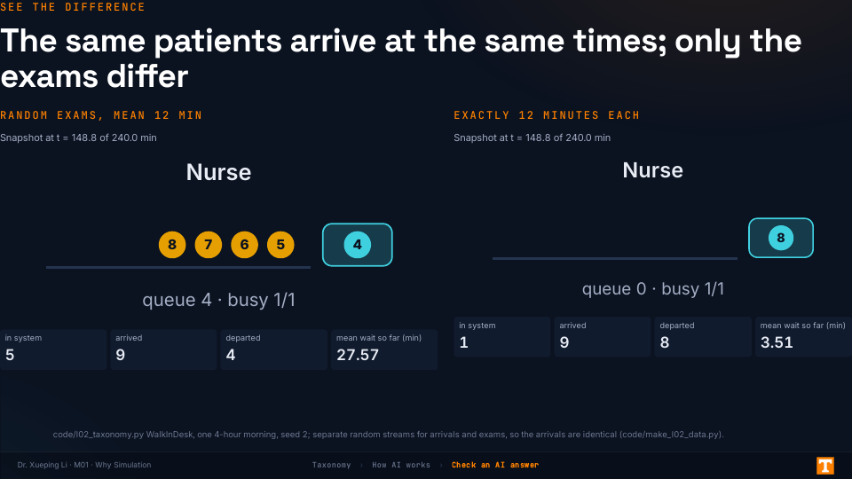

# Module M01 — Why Simulate?

**Book chapters**: Ch. 1 (Why Simulate?), Ch. 2 (Taxonomy of Simulation Models)
**Lectures**: L01, L02, L03–L04 (Lap 1)
**Tier**: Basic and above
**Estimated contact time**: 4 × 75 minutes

## Learning Objectives

By the end of this module, students will be able to:

1. Articulate when simulation is (and is not) the appropriate modeling tool.
2. Classify a given system as discrete/continuous, stochastic/deterministic, and static/dynamic.
3. Describe the 12-step simulation study process.
4. Explain why Python-based simulation is well-suited for AI-augmented practice.

## Contents

| Item | File |
|---|---|
| Lecture 1 live deck (interactive) | `live/L01_why_simulation/`: run `bash cli.sh lecture dev L01` |
| Lecture 1 code (VS Code, `# %%` cells) | `code/l01_averages.py`, tests `code/test_l01_averages.py`, deck data `code/make_l01_data.py` |
| Lecture 1 slides (Beamer) | `slides/L01_why_simulation.tex` |
| Lecture 2 live deck (interactive) | `live/L02_taxonomy_ai/`: run `bash cli.sh lecture dev L02` |
| Lecture 2 code | `code/l02_taxonomy.py`, tests `code/test_l02_taxonomy.py`, deck data `code/make_l02_data.py` |
| Lecture 2 slides (Beamer, content source) | `slides/L02_taxonomy.tex` |
| Lecture 3 live deck (Lap 1: question to first model) | `live/L03_lap1_first_model/`: run `bash cli.sh lecture dev L03` |
| Lecture 3 code | `code/l03_first_model.py`, tests `code/test_l03_first_model.py`, deck data `code/make_l03_data.py` |
| Lecture 4 live deck (Lap 1: first product, what went wrong, teams) | `live/L04_lap1_first_product/`: run `bash cli.sh lecture dev L04` |
| Lecture 4 code | `code/l04_what_went_wrong.py`, tests `code/test_l04_what_went_wrong.py`, deck data `code/make_l04_data.py` |
| AI prompts used in class | `code/PROMPTS.md` |
| Team sign-up handout (L04) | `course/assignments/team_signup.pdf` |
| Lab notebook | `notebooks/L01_simulation_use_cases.ipynb` |
| Assignment | `course/assignments/hw01_conceptual_model.pdf` |
| Reading list | `reading.md` |

## Reading

See `reading.md` for book chapter pointers and suggested supplemental readings.
