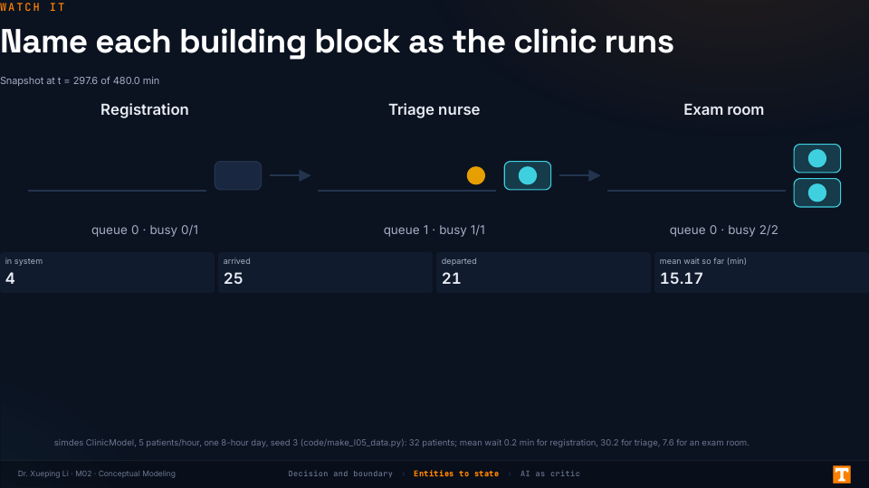

# Module M02 — Conceptual Modeling

**Book chapters**: Ch. 3 (Conceptual Modeling)
**Lectures**: L03, L04 | **Tier**: Basic and above

## Learning Objectives
1. Apply the entity–resource–event–state framework to a new system.
2. Produce a professional conceptual model document with assumptions.
3. Distinguish model scope decisions that affect validity.
4. Critique a peer's conceptual model for missing components.

## Contents
| Item | File |
|---|---|
| Lecture 5 live deck (interactive): boundaries, entities, resources, events, state | `live/L05_conceptual_model/`: run `bash cli.sh lecture dev L05` |
| Lecture 5 code (VS Code, `# %%` cells) | `code/l05_conceptual_model.py`, tests `code/test_l05_conceptual_model.py`, deck data `code/make_l05_data.py`; prompts `code/PROMPTS.md` |
| Lecture 3 slides | `slides/L03_system_boundaries.tex` |
| Lecture 4 slides | `slides/L04_entities_resources.tex` |
| Lab notebook | `notebooks/L03_clinic_conceptual.ipynb` |
| Project | Milestone P1 (proposal and conceptual model): `course/assignments/project_milestones.pdf` |
