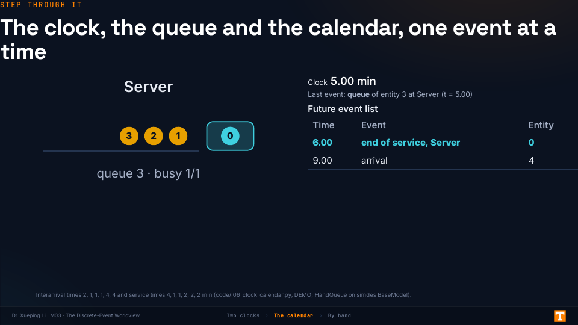

# Module M03 — The Discrete-Event Worldview

**Book chapters**: Ch. 4 (DES Worldview), Ch. 5 (Manual Tracing)
**Lectures**: L05–L08 | **Tier**: Basic and above

## Learning Objectives
1. Describe how a simulation clock, event calendar, and event loop interact.
2. Manually trace a single-server queue for ≥ 10 events.
3. Compute L, Lq, W, Wq from a trace and verify with Little's Law.
4. Explain the process-oriented worldview used by SimPy.

## Contents
| Item | File |
|---|---|
| Lecture 5–6 slides | `slides/L05_simulation_clock.tex`, `slides/L06_event_loop.tex` |
| Lecture 7–8 slides | `slides/L07_manual_tracing.tex`, `slides/L08_littles_law.tex` |
| Lecture 6 live deck (interactive): the clock and the event calendar | `live/L06_clock_calendar/`: run `bash cli.sh lecture dev L06` |
| Lecture 6 code (VS Code, `# %%` cells) | `code/l06_clock_calendar.py`, tests `code/test_l06_clock_calendar.py`, deck data `code/make_l06_data.py` |
| Lecture 7 live deck (interactive): the event loop and the process view | `live/L07_event_loop/`: run `bash cli.sh lecture dev L07` |
| Lecture 7 code | `code/l07_event_loop.py`, tests `code/test_l07_event_loop.py`, deck data `code/make_l07_data.py`; prompts `code/PROMPTS.md` |
| Lecture 8 live deck (interactive): manual tracing | `live/L08_manual_tracing/`: run `bash cli.sh lecture dev L08` |
| Lecture 8 code (VS Code, `# %%` cells) | `code/l08_manual_trace.py`, tests `code/test_l08_manual_trace.py`, deck data `code/make_l08_data.py` |
| Lecture 9 live deck (interactive): Little's law | `live/L09_littles_law/`: run `bash cli.sh lecture dev L09` |
| Lecture 9 code | `code/l09_littles_law.py`, tests `code/test_l09_littles_law.py`, deck data `code/make_l09_data.py` |
| Lab notebook | `notebooks/L07_trace_single_server.ipynb` |
| Assignment | `course/assignments/hw02_manual_trace.pdf` |
