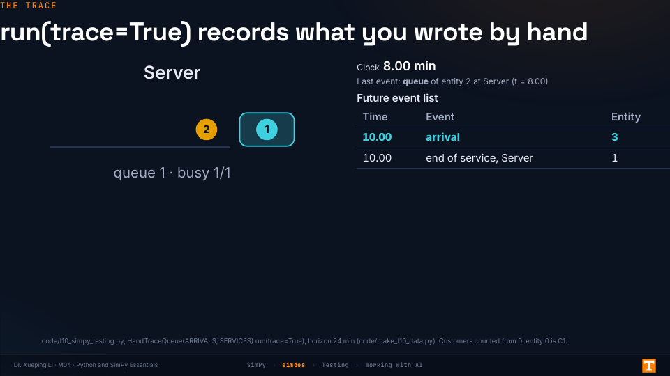

# Module M04 — Python and SimPy Essentials

**Book chapters**: Ch. 6 (Python Tools)
**Lectures**: L09, L10 | **Tier**: Basic and above

## Learning Objectives
1. Set up the Docker/conda/venv environment and run a SimPy hello-world.
2. Use numpy.random.default_rng() for reproducible random variates.
3. Install the simdes package in editable mode and import from it.
4. Write a Python generator function that models a SimPy process.

## Contents
| Item | File |
|---|---|
| Lecture 9 slides | `slides/L09_python_essentials.tex` |
| Lecture 10 slides | `slides/L10_simpy_intro.tex` |
| Lecture 10 live deck (interactive): Python, SimPy and simdes; testing with pytest | `live/L10_python_simpy_testing/`: run `bash cli.sh lecture dev L10` (draws on both Beamer decks above) |
| Lecture 10 code (VS Code, `# %%` cells) | `code/l10_simpy_testing.py`, tests `code/test_l10_simpy_testing.py`, deck data `code/make_l10_data.py`; prompts `code/PROMPTS.md` |
| Lab notebook | `notebooks/L09_simpy_hello_world.ipynb` |
| Lab notebook | `notebooks/L10_simdes_package_tour.ipynb` |
