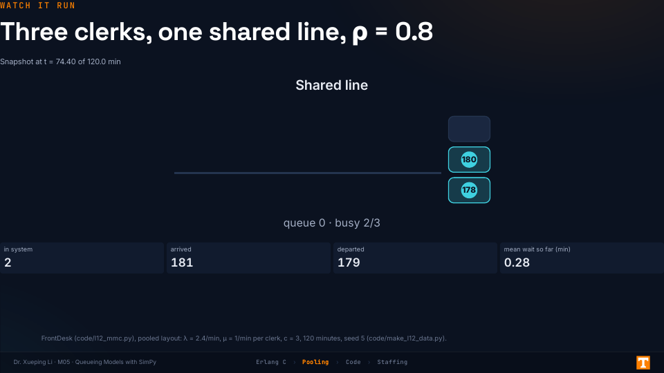

# Module M05 — Queueing Models with SimPy

**Book chapters**: Ch. 7 (SimPy Queues)
**Lectures**: L11–L15 (2027 numbering; Beamer decks L11–L16 are the content sources) | **Tier**: Basic / Intermediate

## Learning Objectives
1. Implement an M/M/1 queue in SimPy and verify against analytical Wq.
2. Extend to M/M/c and observe the effect of adding servers.
3. Model M/G/1 (non-exponential service) and observe the role of variance.
4. Implement a finite-capacity (M/M/1/K) and a priority queue.
5. Explain what it means to "verify" a simulation against theory.

## Contents
| Item | File |
|---|---|
| Slides L11–L16 | `slides/L11_single_server.tex`, `slides/L12_multi_server.tex`, `slides/L13_queue_variability.tex`, `slides/L14_finite_capacity.tex`, `slides/L15_reneging_blocking.tex`, `slides/L16_priority_queue.tex` |
| Live deck (interactive) | `live/L11_single_server/`: run `bash cli.sh lecture dev L11` |
| Live deck L12 | `live/L12_multi_server/`: M/M/c, Erlang C, pooling, staffing (`bash cli.sh lecture dev L12`) |
| Live deck L13 | `live/L13_variability_verification/`: M/G/1, Pollaczek-Khinchine, verification habits (`bash cli.sh lecture dev L13`) |
| Live deck L14 | `live/L14_finite_capacity_reneging/`: M/M/1/K blocking, balking, reneging; P3 reminder (`bash cli.sh lecture dev L14`) |
| Live deck L15 | `live/L15_priority_nonstationary/`: priority classes; thinning and a clinic morning peak (`bash cli.sh lecture dev L15`; content also from `M06_advanced_des/slides/L17_nonstationary_arrivals.tex`) |
| Code (VS Code, `# %%` cells) | `code/l11_mm1.py`, tests `code/test_l11_mm1.py`, deck data `code/make_l11_data.py` |
| Code L12–L15 | `code/l12_mmc.py`, `code/l13_variability.py`, `code/l14_finite_reneging.py`, `code/l15_priority_nonstationary.py`, each with `test_lNN_*.py` and `make_lNN_data.py` (see `code/README.md`) |
| Notebooks | `notebooks/L11_single_server.ipynb`, `L12_multi_server.ipynb`, `L13_multi_stage.ipynb`, `L14_priority_reneging.ipynb` |
| Assignment | `course/assignments/hw03_simpy_queue.pdf` |
