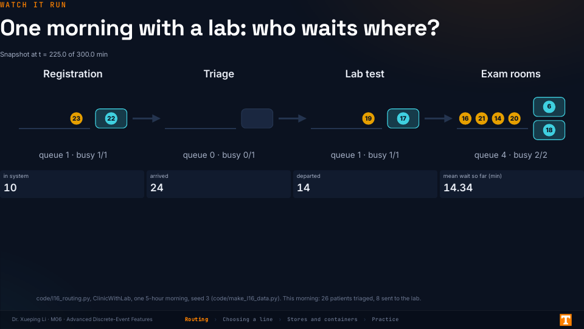

# Module M06 — Advanced Discrete-Event Features

**Book chapters**: Ch. 8 (Advanced DES)
**Lectures**: L17–L22 | **Tier**: Intermediate

## Learning Objectives
1. Model non-stationary arrivals using thinning.
2. Implement entity routing (probabilistic branching) in SimPy.
3. Use simpy.Store for batch arrivals and simpy.Container for inventory.
4. Implement and simulate an (s,S) inventory control policy.
5. Analyze (s,S) cost tradeoffs across reorder-point settings.

## Contents
| Item | File |
|---|---|
| Lecture 16 live deck (interactive) | `live/L16_routing_stores/`: run `bash cli.sh lecture dev L16` |
| Lecture 16 code (VS Code, `# %%` cells) | `code/l16_routing.py`, tests `code/test_l16_routing.py`, deck data `code/make_l16_data.py` |
| Lecture 17 live deck (interactive) | `live/L17_networks_inventory/`: run `bash cli.sh lecture dev L17` |
| Lecture 17 code (VS Code, `# %%` cells) | `code/l17_networks_inventory.py`, tests `code/test_l17_networks_inventory.py`, deck data `code/make_l17_data.py` |
| Slides L17–L20 | `slides/L17_nonstationary_arrivals.tex`, `slides/L18_routing_branching.tex`, `slides/L19_stores_containers.tex`, `slides/L20_multistage_networks.tex` |
| Slides L21–L22 | `slides/L21_ss_inventory.tex`, `slides/L22_ss_scenarios.tex` |
| Notebooks | `notebooks/L17_nonstationary.ipynb` … `notebooks/L20_multistage.ipynb` |
| Notebooks | `notebooks/L21_ss_inventory.ipynb`, `notebooks/L22_ss_scenarios.ipynb` |
| Assignment | `course/assignments/hw04_advanced_des.pdf` |
