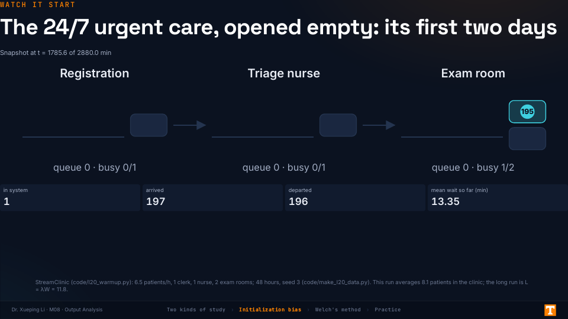

# Module M08 — Output Analysis

**Book chapters**: Ch. 10 (Output Analysis)
**Lectures**: L20–L22 (2027 numbering; Beamer decks L26–L28 are the content sources) | **Tier**: Intermediate

## Learning Objectives
1. Identify and remove the warm-up period using the Welch method.
2. Run independent replications and compute 95% confidence intervals.
3. Determine the required number of replications for a target half-width.
4. Apply common random numbers (CRN) to reduce variance in comparisons.

## Contents
| Item | File |
|---|---|
| Slides L26–L28 (Beamer, retiring) | `slides/L26_warmup_welch.tex`, `slides/L27_replications_ci.tex`, `slides/L28_crn.tex` |
| Live deck L20 | `live/L20_warmup_welch/`: terminating vs. steady state, initialization bias, Welch's method (`bash cli.sh lecture dev L20`) |
| Live deck L21 | `live/L21_replications_ci/`: replications, CIs and coverage, how many days, the single-run trap, batch means (`bash cli.sh lecture dev L21`) |
| Live deck L22 | `live/L22_comparing_alternatives/`: paired-t, CRN with synchronized streams, Bonferroni, a pointer to ranking and selection (`bash cli.sh lecture dev L22`) |
| Code (VS Code, `# %%` cells) | `code/l20_warmup.py`, `code/l21_replications_ci.py`, `code/l22_compare.py`, each with `test_lNN_*.py` and `make_lNN_data.py` (see `code/README.md`) |
| Notebooks | `notebooks/L26_warmup_welch.ipynb` … `notebooks/L28_crn.ipynb` |
| Assignment | `course/assignments/hw06_output_analysis.pdf` |
