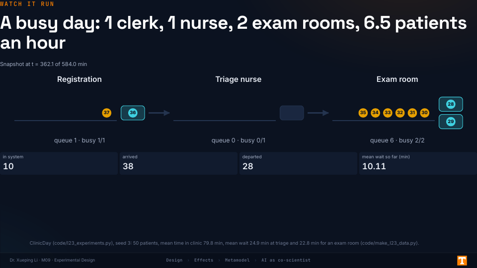

# Module M09 — Experimental Design

**Book chapters**: Ch. 11 (Experimental Design)
**Lectures**: L23 (2027 numbering; Beamer decks L29–L30 are the content sources) | **Tier**: Intermediate

## Learning Objectives
1. Design and analyze a 2^k full-factorial simulation experiment.
2. Compute main effects and interactions; produce an interaction plot.
3. Apply sensitivity analysis (Sobol indices) to identify key inputs.
4. Use ranking-and-selection to identify the best configuration.

## Contents
| Item | File |
|---|---|
| Slides L29–L31 | `slides/L29_factorial_design.tex`, `slides/L30_sensitivity_analysis.tex`, `slides/L31_ranking_selection.tex` |
| Live deck L23 | `live/L23_experiments_ai/`: 2^3 factorial on the clinic, effects and interactions with CIs, a metamodel and its range, the AI as co-scientist checked (`bash cli.sh lecture dev L23`) |
| Code (VS Code, `# %%` cells) | `code/l23_experiments.py`, tests `code/test_l23_experiments.py`, deck data `code/make_l23_data.py` (see `code/README.md`) |
| Notebooks | `notebooks/L29_factorial.ipynb` … `notebooks/L31_ranking_selection.ipynb` |
| Project | Milestone P5 (experiments and results, including a designed experiment): `course/assignments/project_milestones.pdf` |
