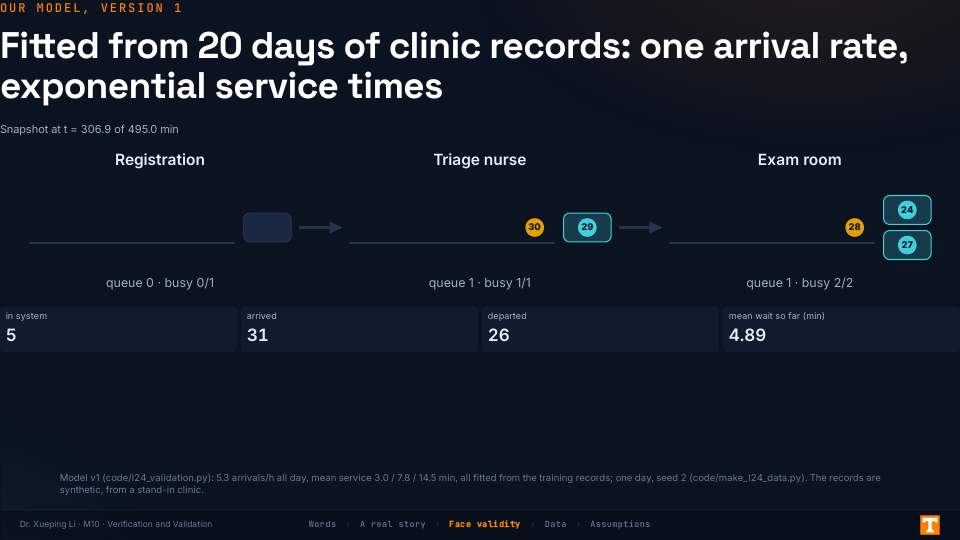

# Module M10 — Verification and Validation

**Book chapters**: Ch. 12 (V&V)
**Lectures**: L24, plus L25 (Ship; 2027 numbering; Beamer decks L33–L35 are the content sources) | **Tier**: Intermediate

## Learning Objectives
1. Distinguish verification, validation, and credibility.
2. Apply structured walkthrough and code review to a SimPy model.
3. Write pytest unit tests that compare simulation output to analytical results.
4. Use trace-based debugging and face validity checks.
5. Build a concise V&V evidence package for a course project.

## Lecture Plan
| Lecture | Focus | In-class activity |
|---|---|---|
| L33 | Verification workflow: structured walkthrough, code review, analytical benchmarks | Debug the intentionally flawed single-server model in `notebooks/L33_verification_debug.ipynb`. |
| L34 | Extreme-condition tests, conservation checks, and trace-based debugging | Write three tests: zero arrivals, instant service, and fixed-input trace. |
| L35 | Validation evidence: face validity, historical validation, sensitivity review | Compare simulated output to a historical baseline and classify gaps as model, data, or scope issues. |
| L36 | Credibility and documentation: assumptions log, V&V matrix, good-enough criteria | Draft the V&V section for the midterm project submission. |

## Contents
| Item | File |
|---|---|
| Slides L33–L36 | `slides/L33_verification_workflow.tex`, `slides/L34_extreme_conditions.tex`, `slides/L35_validation_evidence.tex`, `slides/L36_credibility_documentation.tex` |
| Live deck L24 | `live/L24_verification_validation/`: V&V vocabulary, the Columbia Crater story, face validity, model vs clinic records with an interval and a tolerance, sensitivity to an assumption (`bash cli.sh lecture dev L24`) |
| Live deck L25 | `live/L25_shipping_product/`: the validated model behind an API, showing uncertainty, the dev container and `docker compose up --build`, reviewing an AI diff, deployment; reading pointer to M11–M12 (`bash cli.sh lecture dev L25`) |
| Code (VS Code, `# %%` cells) | `code/l24_validation.py`, `code/l25_ship.py`, each with `test_*.py` and `make_*_data.py` (see `code/README.md`) |
| Debug notebook | `notebooks/L33_verification_debug.ipynb` |
| Project | Milestone P6 (validation and limitations): `course/assignments/project_milestones.pdf` |

## Deliverables
- Completed L33 debug notebook with a corrected model and short explanation of each defect found.
- Project milestone P6: validation evidence and limitations (`course/assignments/project_milestones.pdf`).
- At least one verification test that can be rerun by a grader.
